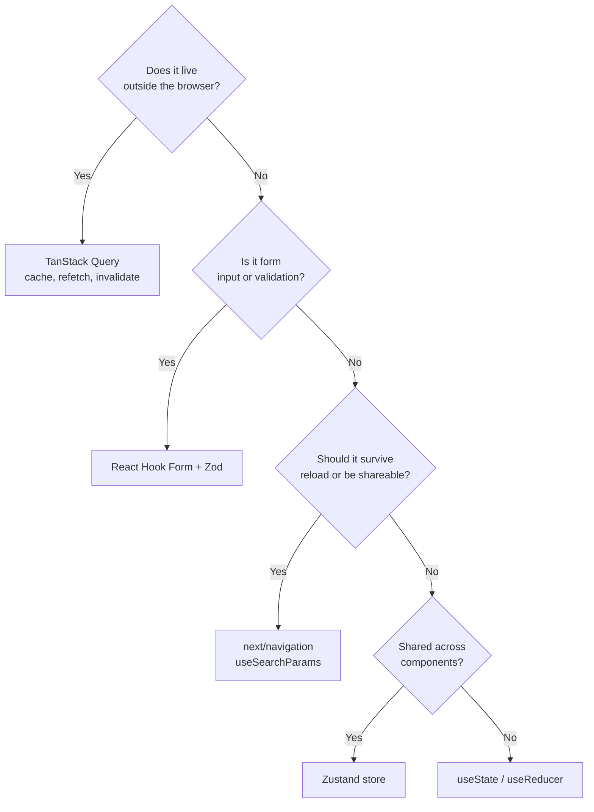

# State Management

This document is the canonical guide to how Lumina Frontend manages state. The core idea is a clear split between **server state** and **client state**, each handled by the tool best suited to it, plus explicit rules for form, URL, and component state.

The architectural rationale for these choices is recorded in the [State Management ADR](adr/0001-state-management.md). The decision tree is also available as a standalone diagram at [docs/diagrams/state-decision.mmd](diagrams/state-decision.mmd).

## The five categories of state

| Category | Examples | Tool |
|----------|----------|------|
| Server state | API responses, contract reads, anything that lives elsewhere and can go stale | [TanStack Query](https://tanstack.com/query) |
| Client state | Wallet session, UI toggles, modals, theme | [Zustand](https://zustand.docs.pmnd.rs/) |
| Form state | Input values, validation errors, submission status | [React Hook Form](https://react-hook-form.com/) + [Zod](https://zod.dev/) |
| URL state | Filters, pagination, search terms, shareable view settings | [`next/navigation`](https://nextjs.org/docs/app/api-reference/functions/use-search-params) (`useSearchParams`) |
| Component state | An open dropdown, a controlled input, transient local UI | `useState` / `useReducer` |

## Decision tree

Work through these questions in order. The first match wins.



1. **Server state** — data with a source of truth outside the browser (the API or the chain). Use TanStack Query.
2. **Form state** — input values, validation, and submission status. Use React Hook Form with a Zod schema.
3. **URL state** — anything that should survive a reload or be shareable via link (filters, pagination, search). Use `useSearchParams` from `next/navigation`.
4. **Client state** — session-only state shared across components. Use a Zustand store.
5. **Component state** — state only one component needs. Use `useState` or `useReducer`.

## Server state: TanStack Query

React Query owns all data fetched from the backend API and from Soroban RPC. It provides caching, deduplication, background refetching, and consistent loading and error states.

- Query keys come from a central factory. See [API_INTEGRATION.md](API_INTEGRATION.md).
- One hook per resource, colocated under `hooks/`.
- Mutations invalidate the affected keys on success so the UI stays in sync.

Do not copy server data into a Zustand store. Read it from React Query where it is needed; the cache is the single source of truth.

## Client state: Zustand

Zustand holds small, app-wide client state. Stores are plain hooks with no provider boilerplate.

```ts
// stores/wallet-store.ts
import { create } from "zustand";

type WalletStatus = "disconnected" | "connecting" | "connected" | "authenticated";

interface WalletState {
  status: WalletStatus;
  publicKey: string | null;
  setConnected: (publicKey: string) => void;
  disconnect: () => void;
}

/**
 * Global wallet session state. Holds connection status and the active
 * public key. Never stores private keys.
 */
export const useWalletStore = create<WalletState>((set) => ({
  status: "disconnected",
  publicKey: null,
  setConnected: (publicKey) => set({ status: "connected", publicKey }),
  disconnect: () => set({ status: "disconnected", publicKey: null }),
}));
```

Usage with a selector so components only re-render when the slice they read changes:

```tsx
const status = useWalletStore((s) => s.status);
const disconnect = useWalletStore((s) => s.disconnect);
```

### Guidelines for stores

- Keep stores small and focused on one concern (wallet, UI, preferences).
- Select narrow slices, not the whole store, to avoid extra re-renders.
- Keep derived values in selectors or components, not duplicated in state.
- Never store secrets or private keys.

## Form state: React Hook Form + Zod

All forms use React Hook Form for state and Zod for validation. Do not hand-roll form state with `useState` or validate inline.

```tsx
const schema = z.object({
  amount: z.string().min(1, "Amount is required"),
});

const form = useForm<z.infer<typeof schema>>({
  resolver: zodResolver(schema),
});
```

- Define the schema once and infer the TypeScript type from it.
- Keep form state local to the form; do not mirror it into a Zustand store.
- On submit, call a React Query mutation and let it invalidate the affected keys.

## URL state: next/navigation

State that should survive a reload or be shareable belongs in the URL. Use `useSearchParams` to read and `useRouter` to write.

```tsx
const searchParams = useSearchParams();
const page = Number(searchParams.get("page") ?? "1");
```

- Use URL state for filters, pagination, search terms, and view settings.
- Do not duplicate URL state in a store; the URL is the source of truth.

## Component state: useState / useReducer

For state that only one component needs (an open or closed dropdown, a controlled input), use `useState` or `useReducer`. Do not promote it to a store until more than one component genuinely needs it.

## Forbidden patterns

These patterns are banned and enforced by ESLint (see `eslint.config.*`). CI's lint job fails on violations.

### Direct `fetch` / `axios` calls

Do not call `fetch` or `axios` directly from components or hooks. All network access goes through `src/services/**`, wrapped by React Query hooks.

```ts
// Banned
const res = await fetch("/api/contracts");

// Correct
const { data } = useContracts();
```

The only place raw `fetch`/`axios` is allowed is inside `src/services/**`.

### Prop drilling beyond 3 levels

Do not pass props through more than 3 component levels. If a value needs to travel deeper, replace the drilling with one of:

- a **Zustand store** for session-only client state,
- a **React Query hook** for server state,
- **React context** for values scoped to a subtree.

## Decision guide

1. Comes from the API or chain? Use TanStack Query.
2. Is it form input or validation? Use React Hook Form + Zod.
3. Should it survive reload or be shareable? Use `useSearchParams`.
4. Shared across components and session-only? Use a Zustand store.
5. Used by a single component? Use local `useState` / `useReducer`.

Following this split keeps the cache authoritative for remote data, keeps client stores small and predictable, and keeps state in the place that best matches its lifetime.

## References

- [State Management ADR](adr/0001-state-management.md)
- [State decision diagram](diagrams/state-decision.mmd)
- [API Integration](API_INTEGRATION.md)
